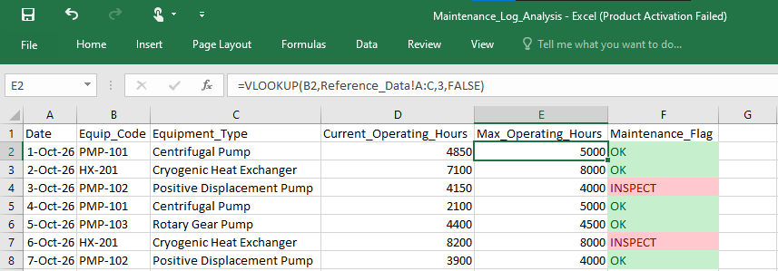

# Project 2: Industrial Maintenance Log Analysis

## 📌 Objective
To automate the processing of daily industrial equipment logs and flag machines requiring immediate inspection based on maximum safe operating hours.

## 🛠️ Skills & Tools Used
*   **Data Relational Mapping (VLOOKUP):** Retrieved `Equipment_Type` and `Max_Operating_Hours` from a master reference database using unique equipment codes.
*   **Logical Functions (IF):** Automated decision-making to generate an "Inspect" or "OK" flag by comparing current operating hours against safety limits.
*   **Conditional Formatting:** Applied visual color-coding to instantly highlight equipment at risk of failure.

## 📊 Maintenance Dashboard

