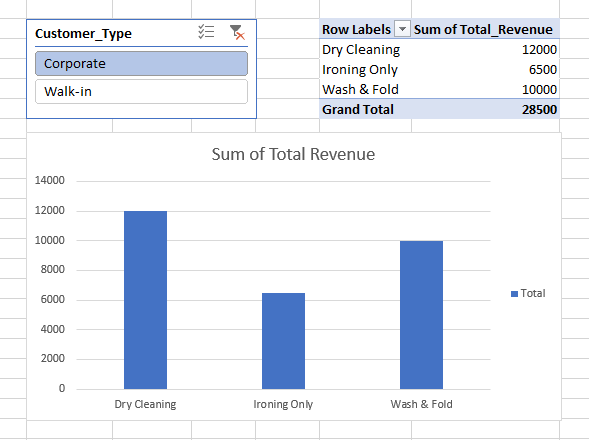

# Project 4: Gas Retail Operations Dashboard (Power BI)

## 📌 Objective
To transition from spreadsheet-based reporting to a dynamic business intelligence tool, enabling retail stakeholders to instantly analyze fuel distribution and revenue across different product lines.

## 🛠️ Skills & Tools Used
*   **Power BI Desktop:** Built an interactive executive dashboard from raw transactional logs.
*   **Power Query:** Conducted ETL (Extract, Transform, Load) processes to split delimited text strings into structured data columns and clean historical data.
*   **Data Visualization:** Designed cross-filtering visuals, including an aggregated KPI card, a date slicer, and categorical bar charts to isolate specific revenue streams (PMS, AGO, LPG).

## 📊 Operations Dashboard

